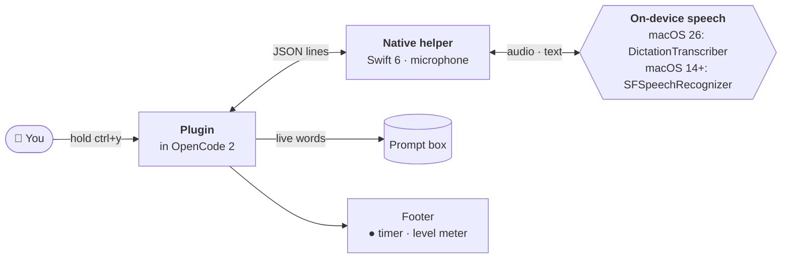
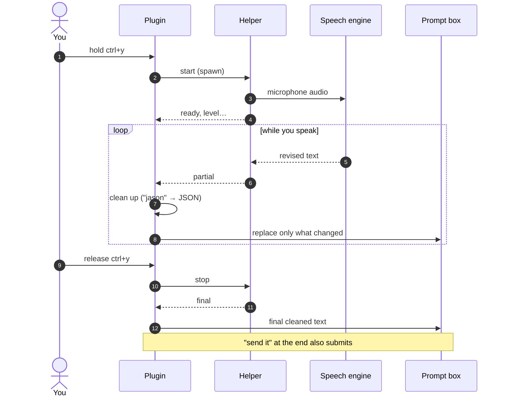

<div align="center">


**Talk instead of type in [OpenCode](https://opencode.ai/).**

Hold a key, say your prompt, let go. Your words appear in the prompt box as you speak.<br>
No downloads. No API keys. No extra programs. Recognized on-device.

[](https://github.com/batuhansk/opencode-talk/actions/workflows/ci.yml) [](https://www.npmjs.com/package/opencode-talk)   [](LICENSE)

</div>

<!-- Optional: add a short screen recording (docs/demo.gif) of holding ctrl+y and talking. -->

## Contents

- [Why](#why)
- [Install](#install)
- [Use](#use)
- [What gets cleaned up](#what-gets-cleaned-up)
- [Languages](#languages)
- [Options](#options)
- [Speech engines](#speech-engines)
- [Troubleshooting](#troubleshooting)
- [Privacy](#privacy)
- [How it works](#how-it-works)
- [Development](#development)
- [Releasing](#releasing)
- [Roadmap](#roadmap)

## Why

Most voice setups for coding tools need whisper.cpp, sox, a ~600 MB model and an
LLM call on every prompt. opencode-talk uses the speech recognition already built
into macOS and cleans up coding terms with fast local rules.

|                              | opencode-talk          | Typical whisper-based plugin      |
| ---------------------------- | ---------------------- | --------------------------------- |
| Install                      | One plugin line        | Homebrew packages, Python, models |
| Download size                | ~180 kB package        | ~700 MB                           |
| API key / per-prompt AI call | None                   | Usually                           |
| Words appear while you speak | Yes, in the prompt box | No (record, then transcribe)      |
| Works offline                | Yes                    | Depends                           |

## Install

You need **OpenCode 2** and **macOS 14 (Sonoma) or later**.

Add the plugin to `~/.config/opencode/cli.json`:

```json
{
  "$schema": "https://opencode.ai/v2/cli.json",
  "plugins": ["opencode-talk"]
}
```

Restart OpenCode. The first time you talk, macOS asks to allow **Microphone** and
**Speech Recognition** for `opencode-talk-helper`. Allow both.

## Use

| Do this                       | What happens                               |
| ----------------------------- | ------------------------------------------ |
| **Hold** `ctrl+y`             | Talk while holding; release to finish      |
| **Tap** `ctrl+y`              | Start; tap again, or pause ~2 s, to finish |
| `ctrl+x` then `v`, or `/talk` | Same as tapping (no hold)                  |
| `esc`                         | Cancel and remove what was said            |
| `/talk:language`              | Switch the language you speak              |
| End with **"send it"**        | Finish and submit in one go                |

Your words appear **in the prompt box as you speak**, at your cursor, and get
corrected as the recognizer refines them. When you finish, the cleaned-up text
stays there so you can edit it before pressing Enter.

The footer shows a timer and a microphone level meter (`● 0:04 ▂▅▇▃`), so you
can see the mic is hearing you.

> [!TIP]
> Hold-to-talk works in any terminal. Terminals don't report key releases to
> OpenCode, so the plugin watches the key-repeat stream your terminal sends
> while a key is held. When it stops, you've let go.

> [!NOTE]
> If you type or move the cursor while talking, the plugin stops touching the
> prompt so it never overwrites your edits.

## What gets cleaned up

Recognizers don't know how developers talk. Local rules fix that, with no AI call:

| You say                                     | You get                        |
| ------------------------------------------- | ------------------------------ |
| "fix the **jason** parser"                  | Fix the **JSON** parser        |
| "make it a **bullion**"                     | Make it a **boolean**          |
| "run **cube control** get pods"             | Run **kubectl** get pods       |
| "rename it to **camel case get user name**" | Rename it to **`getUserName`** |
| "**snake case** max retry count"            | **`max_retry_count`**          |
| "**pascal case** user service"              | **`UserService`**              |
| "call **backtick** foo **backtick**"        | Call **`` `foo` ``**           |
| "first **comma** then **period**"           | First, then.                   |
| "**um** fix it"                             | Fix it                         |

Also supported: kebab case, constant case, "new line", "question mark",
"colon", "open/close paren", and 30+ common terms (GitHub, TypeScript, Node.js,
README, .env, PR, API, SQL, YAML, GraphQL, Postgres, OpenCode, ...).
These terms are also sent to the recognizer as hints, which improves accuracy.
Add your own with the [`vocab`](#options) option.

## Languages

Apple's speech engines recognize **one language at a time** and don't detect
which language you're speaking, so, like macOS Dictation, you pick it:

- **By default** you get the preferred languages from System Settings →
  General → Language & Region that Apple can recognize. Set `languages` to
  choose your own list.
- **Switch** with `/talk:language` (or the command palette, or a key via
  `languageKeybind`). It shows each language and whether it runs on-device.
- **Any language your Mac supports:** pick **More languages…** in the same
  picker to search every language Apple can recognize (63 on macOS 26) and add
  one. Added languages stay in the picker; press `ctrl+d` on one to remove it.
- **Your choice is remembered** across restarts, and the footer shows the
  active one, e.g. `● 0:03 ▂▅▇ DE`.
- **Models download automatically.** On macOS 26, Apple's on-device dictation
  model is installed for each of your languages in the background.

```json
{ "package": "opencode-talk", "options": { "languages": ["en-US", "de-DE", "ja-JP"] } }
```

Cleanup follows the active language. Tech terms like JSON are fixed in every
language. Spoken punctuation and the "send it" command currently exist for
English and Turkish ("virgül", "nokta", "soru işareti", "yeni satır",
"gönder"); in other languages, the recognizer's own punctuation is kept.

To see what your Mac supports:

```bash
opencode-talk-helper languages          # your System Settings languages
opencode-talk-helper languages --all    # everything this Mac can recognize
```

## Options

Pass options with the object form in `cli.json`:

```json
{
  "$schema": "https://opencode.ai/v2/cli.json",
  "plugins": [
    {
      "package": "opencode-talk",
      "options": {
        "keybind": "ctrl+y,<leader>v",
        "mic": "MacBook",
        "liveText": true,
        "autoSend": false,
        "silenceStop": 2,
        "engine": "auto",
        "languages": ["en-US", "de-DE"],
        "onDeviceOnly": true,
        "vocab": { "acme db": "AcmeDB", "super base": "Supabase" },
        "hints": ["Drizzle", "tRPC"]
      }
    }
  ]
}
```

| Option            | Default              | Description                                                                                                  |
| ----------------- | -------------------- | ------------------------------------------------------------------------------------------------------------ |
| `keybind`         | `"ctrl+y,<leader>v"` | Talk keys, comma-separated. Hold only works with a single chord like `ctrl+y`.                               |
| `mic`             | system input         | Microphone by name fragment, e.g. `"MacBook"`, `"AirPods"`. List with `opencode-talk-helper mics`.           |
| `liveText`        | `true`               | Show words in the prompt while you speak. When `false`, they show in the footer and are inserted at the end. |
| `autoSend`        | `false`              | Submit right after finishing, without saying "send it".                                                      |
| `silenceStop`     | `2`                  | Seconds of silence before finishing in tap mode. `0` disables.                                               |
| `engine`          | `"auto"`             | `auto`, `dictation` (macOS 26) or `legacy`. See [Speech engines](#speech-engines).                           |
| `languages`       | System Settings      | Languages you speak, e.g. `["en-US", "tr-TR"]`. Switch with `/talk:language`. See [Languages](#languages).   |
| `onDeviceOnly`    | `true`               | Never send audio to Apple's servers. Set `false` to allow them for languages without on-device support.      |
| `languageKeybind` | none                 | Optional key for the language picker.                                                                        |
| `vocab`           | `{}`                 | Extra spoken → written replacements. Also used as recognition hints.                                         |
| `hints`           | `[]`                 | Extra words to bias recognition, without replacing anything.                                                 |

## Speech engines

opencode-talk picks the best engine available, automatically:

| Engine      | macOS | Notes                                                                                                  |
| ----------- | ----- | ------------------------------------------------------------------------------------------------------ |
| `dictation` | 26+   | Apple's newer on-device dictation model (`SpeechAnalyzer`). Installed once by macOS in the background. |
| `legacy`    | 14+   | `SFSpeechRecognizer`, on-device when your language supports it.                                        |

On macOS 26 the plugin asks macOS to install the dictation model for each of
your languages on start. If a language has no on-device legacy support, the
model is downloaded before the first talk. Force an engine with the `engine` option.

## Troubleshooting

<details>
<summary><b>I talk but nothing happens</b></summary>

Watch the level meter in the footer while you talk.

- **Bars don't move:** the mic hears nothing. If you get a warning naming your
  mic (for example "AirPods Pro isn't picking up any sound"), the device is
  connected but silent: AirPods in their case, a muted headset, or a closed
  MacBook lid (which turns off the built-in mic). Pick another one with the
  `mic` option.
- **Bars move, no words:** check System Settings → Privacy & Security →
  Speech Recognition, and that `lang` matches the language you speak.

</details>

<details>
<summary><b>Words come out wrong in another language</b></summary>

The recognizer only understands the active language. Speaking, say, German
while English is active produces English-sounding nonsense. Switch with
`/talk:language`, or add the language to `languages` (or to System Settings →
Language & Region).

</details>

<details>
<summary><b>The key does nothing, or opens something else</b></summary>

Your terminal may use that key for itself. For example, Warp and OpenCode both
use `ctrl+g`, which is why the default is `ctrl+y`. Use `ctrl+x v` or `/talk`,
or set another `keybind`.

</details>

<details>
<summary><b>No permission prompt appeared / permission denied</b></summary>

Open System Settings → Privacy & Security → **Microphone** and **Speech
Recognition**, and allow `opencode-talk-helper`. Then check from a terminal:

```bash
~/.cache/opencode/packages/opencode-talk/bin/opencode-talk-helper check
```

(The path depends on where OpenCode installed the package.)

</details>

<details>
<summary><b>Words land in the clipboard instead of the prompt</b></summary>

That happens when the prompt box isn't focused when you start talking. Press
`⌘V` to paste, and click into the prompt before talking next time.

</details>

## Privacy

Speech is recognized on your Mac. The plugin makes no network requests and has
no telemetry. The only downloads are Apple's own on-device dictation models on
macOS 26, managed by macOS.

By default (`onDeviceOnly: true`) audio never leaves your Mac: if a language
can't run on-device, the plugin tells you instead of using Apple's servers.
Setting `onDeviceOnly: false` allows Apple's servers for such languages
(Apple's Siri/Dictation privacy terms apply).

## How it works



| Part                | Does                                                              |
| ------------------- | ----------------------------------------------------------------- |
| `tui.js`            | Keys, footer indicator, wiring                                    |
| `lib/live.js`       | Types words into the prompt as they arrive; backs off if you edit |
| `lib/clean.js`      | Coding terms, naming styles, spoken punctuation, "send it"        |
| `lib/ptt.js`        | Tells tap from hold using key repeats                             |
| `lib/helper.js`     | Starts the helper and reads its JSON events                       |
| `helper/main.swift` | Microphone capture and speech recognition                         |

What happens when you hold the key:



The helper never leaves the microphone on: signals end it immediately, it
exits if its parent goes away, and every session is capped at 10 minutes. It
relaunches itself as its own "responsible" process so the macOS permission
prompt names the helper and works from any terminal.

## Development

```bash
git clone https://github.com/batuhansk/opencode-talk && cd opencode-talk
npm run build   # universal helper binary, Swift 6 strict, warnings as errors
npm test        # cleanup rules, live preview, push-to-talk, helper end-to-end
```

Point `cli.json` at your checkout to try it in OpenCode:

```json
{ "plugins": ["/path/to/opencode-talk"] }
```

Helper commands:

```bash
bin/opencode-talk-helper check                         # permissions, active engine
bin/opencode-talk-helper languages                     # your languages and on-device support
bin/opencode-talk-helper mics                          # list microphones
bin/opencode-talk-helper prepare --lang tr-TR          # install the macOS 26 model
bin/opencode-talk-helper listen --engine dictation     # talk; type "stop" + Enter
bin/opencode-talk-helper transcribe clip.aiff          # transcribe a file
```

Set `OPENCODE_TALK_DEBUG=1` for diagnostics on stderr, and
`OPENCODE_TALK_TEST_FILE=clip.aiff` to stream a file through the live pipeline
instead of the microphone (used by the tests).

Helper tests need Speech Recognition permission, so they skip on CI.

## Releasing

GitHub Actions does the work:

- **CI** on every push and pull request: builds on macOS 14 and 15, verifies a
  signed universal binary, runs the tests, checks formatting and package contents.
- **Release** on a `v*` tag: checks the tag matches `package.json`, builds,
  tests, publishes to npm with provenance, and creates a GitHub Release with the
  helper attached and notes from `CHANGELOG.md`.

```bash
npm version minor        # bumps package.json and creates the tag
git push --follow-tags   # GitHub Actions publishes
```

One-time setup: on npmjs.com, add this repo as a trusted publisher for
`opencode-talk` (workflow `release.yml`, environment `npm`), or add an
`NPM_TOKEN` repository secret.

## Roadmap

- Project-aware vocabulary: file names and identifiers from your repo as hints
- Spoken punctuation and voice commands for more languages (English and Turkish today; contributions welcome)
- Developer ID signing and notarization, so macOS doesn't ask for permission again after updates
- Windows helper (`Windows.Media.SpeechRecognition`), same JSON protocol
- Linux helper (Vosk, small one-time model)
- An official OpenCode API for editing the prompt (today the plugin edits the focused text box directly)

Ideas and pull requests welcome: [open an issue](https://github.com/batuhansk/opencode-talk/issues).

## License

MIT © [Batuhan Saka](https://github.com/batuhansk)
